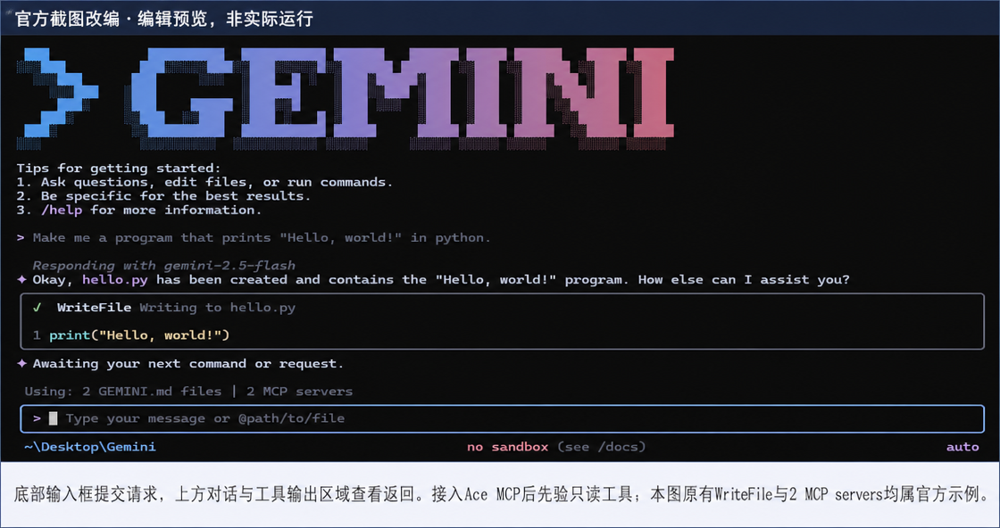

# Seedance by Ace Data Cloud for Gemini CLI

Use Seedance text-to-video and image or multimodal-reference video generation, then retrieve the original task from Gemini CLI. **Ace Data Cloud** provides this independent integration; it is not an official Seedance or Google product and does not add a main-model provider.

[简体中文](readme/README_zh_Hans.md) · [Current price](https://platform.acedata.cloud/models?utm_source=gemini-cli&utm_medium=referral&utm_campaign=evergreen&utm_content=seedancegemini_pricing)

## 1. Install through Gemini CLI extensions

Install [Google Gemini CLI](https://geminicli.com/docs/get-started/installation/) and complete its current main-model authentication. Tested version: **0.64.0**. Google directs some unpaid/Google One users to [Antigravity CLI](https://github.com/google-gemini/gemini-cli#readme); this package does not claim Antigravity compatibility.

This independent native extension uses manifest ID **seedance-by-ace-data-cloud** and publisher **AceDataCloud/SeedanceGemini**. Install the release from its public repository:

```bash
gemini extensions install https://github.com/AceDataCloud/SeedanceGemini
```

Pin version **v0.1.0** when you need a reproducible install:

```bash
gemini extensions install https://github.com/AceDataCloud/SeedanceGemini --ref v0.1.0
```

[Versioned release](https://github.com/AceDataCloud/SeedanceGemini/releases/tag/v0.1.0) · [Official gallery](https://geminicli.com/extensions/). Gallery indexing is a separate daily process; published source/release and passing installation do not prove a search card is present.

Read the native consent prompt. The extension adds only Seedance MCP tools, the `seedance-video` Skill and `/seedance-check`, `/seedance-task`. No hooks, local server install or automatic media generation.

## 2. Register/sign in and get a service Token

1. [Register or sign in to Ace](https://platform.acedata.cloud?utm_source=gemini-cli&utm_medium=referral&utm_campaign=evergreen&utm_content=seedancegemini_register).
2. Open [Applications](https://platform.acedata.cloud/console/applications?utm_source=gemini-cli&utm_medium=referral&utm_campaign=evergreen&utm_content=seedancegemini_api_key). Initialize **General application** if missing. Check Seedance entitlement and current balance. A service application's Key is limited to that service; general keys remain subject to account/API restrictions.
3. Copy **API KEY** from the card, or **Manage Keys → Create** for a dedicated Key named `Gemini CLI Seedance`.


4. Review expiration, usage limits and Allowed APIs. This workflow uses `/seedance/videos`, `/seedance/tasks`. Allow only needed routes. Review [current pricing](https://platform.acedata.cloud/models?utm_source=gemini-cli&utm_medium=referral&utm_campaign=evergreen&utm_content=seedancegemini_before_run) before a generation.


These are authentic masked shared Ace screens reused from SunoDify; the pictured `Dify tutorial` name is illustrative—use `Gemini CLI Seedance` here. Retrieved/reviewed 2026-10-18; original capture date unspecified. [Exact sources and limits](_assets/tutorial/sources.json).

Paste only the raw Token, without `Bearer `, quotes or masked characters. A `platform-...` account-management token is not the service Key. Trial balance and permissions are whatever your account currently displays.

## 3. Use the native password setting

During install, paste the Key at **Ace Data Cloud Seedance API Token**, not in chat. `sensitive: true` uses Gemini CLI's native secret storage (OS keychain if available, secure fallback otherwise). To change it:

```bash
gemini extensions config seedance-by-ace-data-cloud "Ace Data Cloud Seedance API Token"
```

Extension-specific variable: `ACEDATACLOUD_SEEDANCE_TOKEN`. No manual MCP URL/JSON configuration is required. Restart Gemini CLI and check:

```bash
gemini extensions list
gemini mcp list
```

Expect `seedance-by-ace-data-cloud` enabled/connected. Respect administrator extension/MCP policy. Same-name MCP entries in settings take precedence.



**Official screenshot edit, not this extension's execution.** Edited 2026-10-17; source asset updated 2025-12-01, capture date/version unspecified. Bottom input receives requests, replies/tool results appear above. WriteFile, Hello World and “2 MCP servers” belong to the Google example; this does not show Seedance's native password prompt or prove installation. [Sources](_assets/tutorial/sources.json), [Apache notice](THIRD_PARTY_NOTICES.md), [actual validation boundaries](VALIDATION.md).

## 4. First use without creating media

Run `/seedance-check` inside Gemini CLI. It calls `seedance_list_models` for reference information, not media generation, balance or billing. Your configured main model can still charge for inference.

## 5. Authorized operation and same-task retrieval

Text-to-video and first/last-frame or multimodal image-to-video. Use reference_image_urls/reference_audio_urls/reference_video_urls as actual arrays, not comma-separated strings. Validate duration/resolution/ratio against the current schema and selected model; do not add web search, extra audio/reference operations, edit or extend implicitly. Do not hardcode a model based on an outdated description.

Before the requested operation, inspect its current model/schema/price and confirm the user's budget. Submit once and preserve the returned original task ID. Then query **`seedance_get_task(task_id=ORIGINAL_TASK_ID)`** until terminal success or failure; pending/processing is not completed media. A timeout or 5xx does not authorize regeneration.

For an already-submitted task:

```text
/seedance-task YOUR_ORIGINAL_TASK_ID
```

This command retrieves that ID only. No new generation or fabricated ID is needed. Show actual returned video URLs and terminal state; verify media and the matching consumption record separately. A connected server, task ID or green CLI turn does not prove a completed image/video, unique bill or revenue.

This extension exposes the two generation tools listed below; it does not add dedicated video editing or extension tools.

## Exposed tools

`seedance_list_models`, `seedance_list_resolutions`, `seedance_list_actions`, `seedance_generate_video`, `seedance_generate_video_from_image`, `seedance_get_task`, `seedance_get_tasks_batch`.

Other services/tools from the underlying server are excluded. [Maintained server source](https://github.com/AceDataCloud/SeedanceMCP) owns the actual API contract; this repository does not duplicate it.

## Troubleshooting and charges

| Issue | Action |
|---|---|
| 401 / missing Key | Native config command; check raw service Key, expiration and service access. |
| 403 | Read actual permission/moderation error; check Allowed APIs. |
| No password prompt | Ensure extension settings are enabled; use config. Never paste Key into chat. |
| No tools | Restart, check extensions/MCP list and admin policy. Do not bypass restrictions. |
| Pending / timeout | Query original ID again; no automatic second paid submission. |
| Invalid input/model | Inspect the selected tool schema; do not copy another service's fields. |
| 429 / 5xx / failed | Preserve task/trace ID and inspect original history before deciding on any fresh operation. |

Ace media tools and the configured Gemini main model have separate prices. [Applications and usage](https://platform.acedata.cloud/console/applications?utm_source=gemini-cli&utm_medium=referral&utm_campaign=evergreen&utm_content=seedancegemini_usage) report Credits; USD uses the current package price/amount. This repository claims no acquired registrations, paying users or revenue.

## Update/remove and publication gate

```bash
gemini extensions update seedance-by-ace-data-cloud
gemini extensions uninstall seedance-by-ace-data-cloud
```

[Validation](VALIDATION.md) · [Official gallery handoff](docs/GALLERY_SUBMISSION.md) · [Native extension mechanism](https://geminicli.com/docs/extensions/releasing/)

Code: MIT. Official screenshot derivative: Apache-2.0 with included license/notices. Service and Google/Gemini marks belong to their owners; no endorsement is implied.
